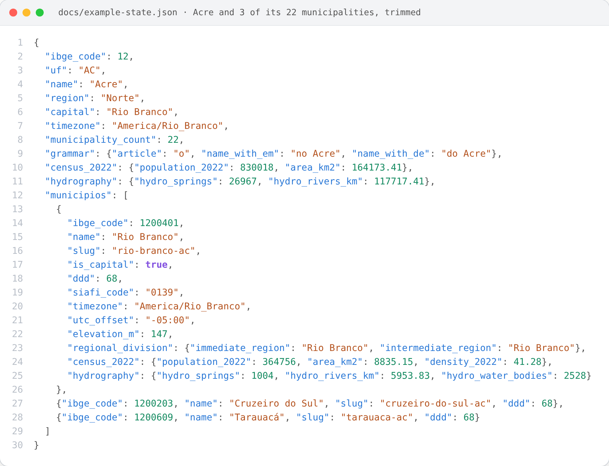
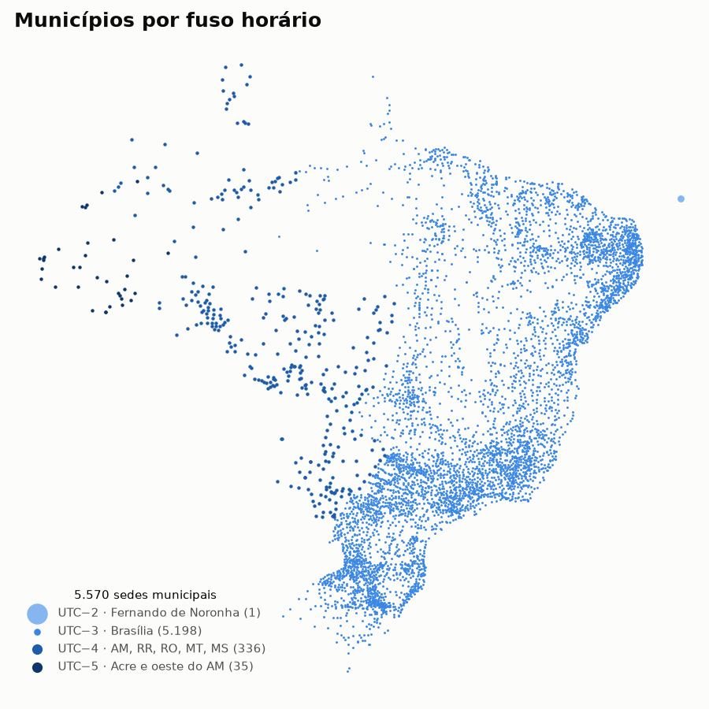
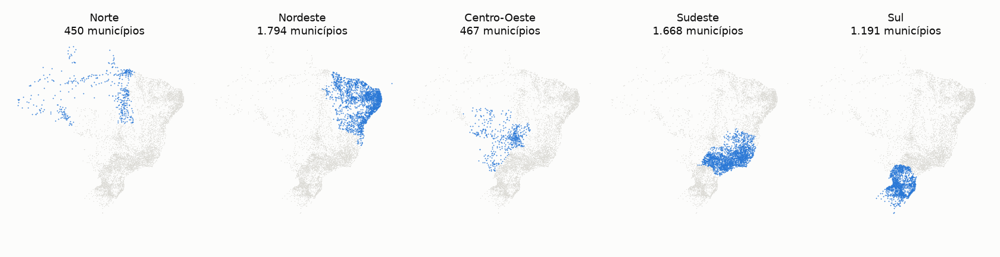
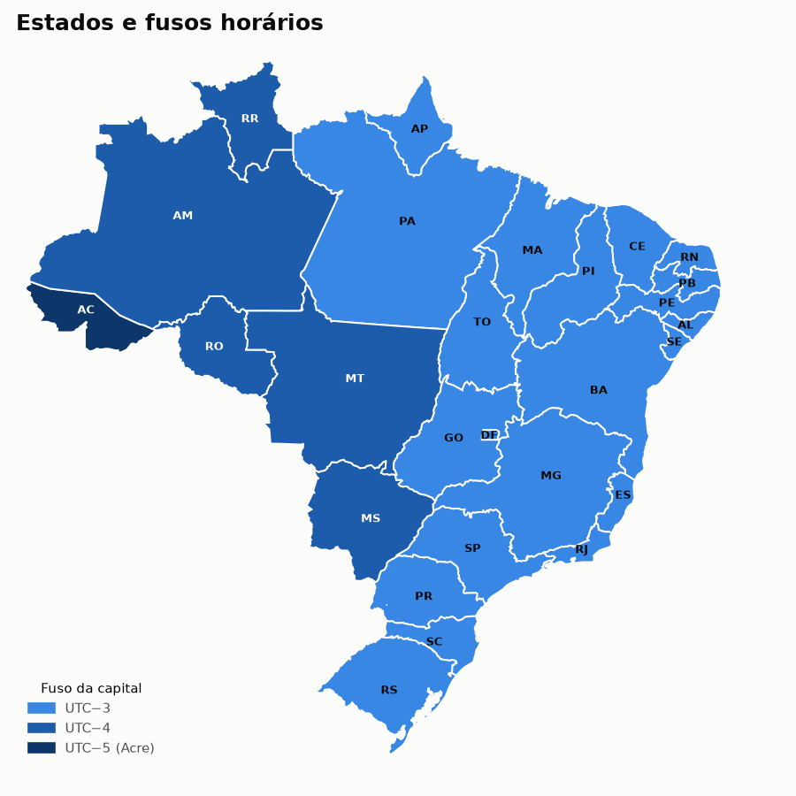
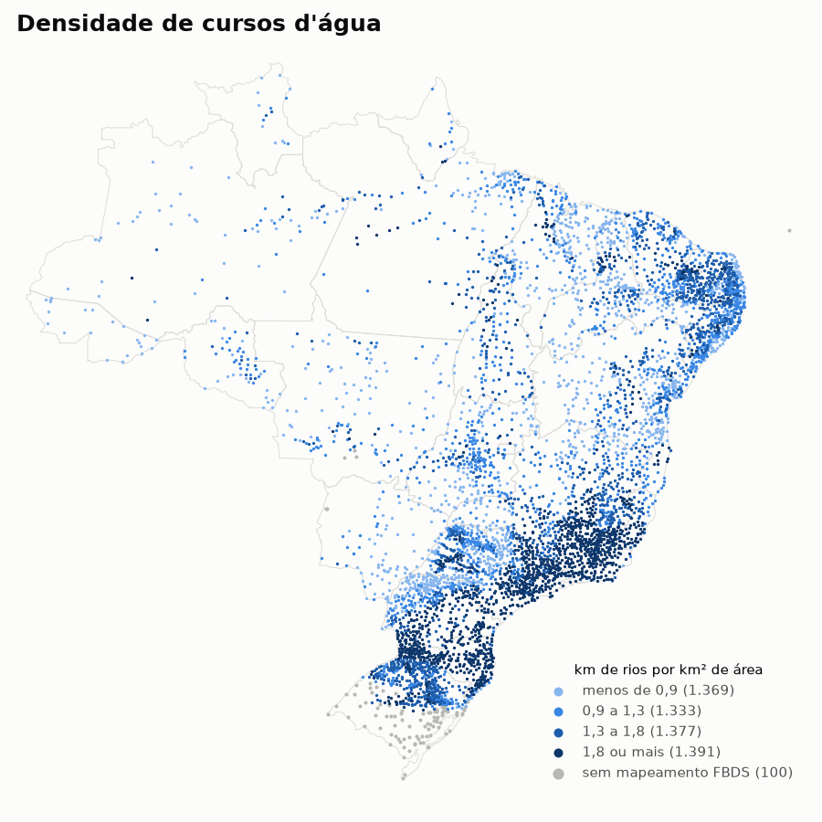

# Municípios e estados do Brasil · Brazilian municipalities and states

[](https://github.com/CaiqueDourado/municipios-e-estados-do-brasil/actions/workflows/validate.yml)
[](LICENSE-DATA.md)
[](LICENSE)
[](https://www.kaggle.com/datasets/caiquedourado/municipios-e-estados-do-brasil)

**pt-BR:** Os 5.570 municípios e as 27 UFs do Brasil com códigos IBGE e SIAFI, DDD, fusos horários IANA, coordenadas, slug e a gramática de cada estado ("no Acre", "em Goiás") para geração de texto.
**en:** All 5,570 Brazilian municipalities and 27 states with IBGE and SIAFI codes, phone area codes, IANA time zones, coordinates, URL slugs and the grammar each state name takes in Portuguese, for text generation.

[Leia em português](README.pt-BR.md) · **[Open the interactive explorer](https://caiquedourado.github.io/municipios-e-estados-do-brasil/)**

| Table | Rows | Columns | Formats | Checks |
|---|---|---|---|---|
| `municipios` | 5,570 | 36 | CSV · Parquet · JSON · GeoJSON | IBGE check digit, unique keys, coordinates, DDD, zones, census consistency |
| `estados` | 27 | 19 | CSV · Parquet · JSON · GeoJSON | grammar consistency, joins with `municipios` |

## Preview

| ibge_code | name | uf | region | ddd | siafi_code | timezone | utc_offset | slug |
|---|---|---|---|---|---|---|---|---|
| 3550308 | São Paulo | SP | Sudeste | 11 | 7107 | America/Sao_Paulo | -03:00 | sao-paulo-sp |
| 2927408 | Salvador | BA | Nordeste | 71 | 3849 | America/Bahia | -03:00 | salvador-ba |
| 1302405 | Lábrea | AM | Norte | 97 | 0251 | America/Eirunepe | -05:00 | labrea-am |
| 2605459 | Fernando de Noronha | PE | Nordeste | 81 | 3001 | America/Noronha | -02:00 | fernando-de-noronha-pe |
| 5300108 | Brasília | DF | Centro-Oeste | 61 | 9701 | America/Sao_Paulo | -03:00 | brasilia-df |

| uf | name | capital | article | name_with_em | name_with_de |
|---|---|---|---|---|---|
| AC | Acre | Rio Branco | o | no Acre | do Acre |
| BA | Bahia | Salvador | a | na Bahia | da Bahia |
| GO | Goiás | Goiânia | | em Goiás | de Goiás |
| SP | São Paulo | São Paulo | | em São Paulo | de São Paulo |

## How a state is structured



One row of `estados`, Acre, with its columns grouped and its 22 municipalities from `municipios` nested under it
by `state_ibge_code`, the capital first. The state takes an article ("no Acre", "do Acre") and has 830,018
people in the 2022 Census; Rio Branco, its capital, has 364,756, DDD 68, SIAFI code `0139` and UTC offset `-05:00`. Full
record: [`docs/example-state.json`](docs/example-state.json), built by [`scripts/make_json.py`](scripts/make_json.py).

## Map

**[Interactive explorer](https://caiquedourado.github.io/municipios-e-estados-do-brasil/)**: pick any municipality to see its boundary, its data and the weather forecast. Change the code in the address (`?ibge=2927408`) to jump to another one.





Every row has coordinates, so the data draws Brazil by itself. Two ways to explore it interactively on GitHub:

- **All 5,570 municipalities:** open [`data/municipios.geojson`](data/municipios.geojson). GitHub renders it as a zoomable map; click a point to see its IBGE code, DDD and time zone.
- **The 27 capitals**, right here (GitHub renders the block below as a map):

```geojson
{"type": "FeatureCollection", "features": [{"type": "Feature", "geometry": {"type": "Point", "coordinates": [-67.8243, -9.97499]}, "properties": {"capital": "Rio Branco", "uf": "AC", "ibge_code": 1200401, "ddd": 68, "timezone": "America/Rio_Branco"}}, {"type": "Feature", "geometry": {"type": "Point", "coordinates": [-35.735, -9.66599]}, "properties": {"capital": "Maceió", "uf": "AL", "ibge_code": 2704302, "ddd": 82, "timezone": "America/Maceio"}}, {"type": "Feature", "geometry": {"type": "Point", "coordinates": [-60.0212, -3.11866]}, "properties": {"capital": "Manaus", "uf": "AM", "ibge_code": 1302603, "ddd": 92, "timezone": "America/Manaus"}}, {"type": "Feature", "geometry": {"type": "Point", "coordinates": [-51.0694, 0.034934]}, "properties": {"capital": "Macapá", "uf": "AP", "ibge_code": 1600303, "ddd": 96, "timezone": "America/Belem"}}, {"type": "Feature", "geometry": {"type": "Point", "coordinates": [-38.5011, -12.9718]}, "properties": {"capital": "Salvador", "uf": "BA", "ibge_code": 2927408, "ddd": 71, "timezone": "America/Bahia"}}, {"type": "Feature", "geometry": {"type": "Point", "coordinates": [-38.5423, -3.71664]}, "properties": {"capital": "Fortaleza", "uf": "CE", "ibge_code": 2304400, "ddd": 85, "timezone": "America/Fortaleza"}}, {"type": "Feature", "geometry": {"type": "Point", "coordinates": [-47.9297, -15.7795]}, "properties": {"capital": "Brasília", "uf": "DF", "ibge_code": 5300108, "ddd": 61, "timezone": "America/Sao_Paulo"}}, {"type": "Feature", "geometry": {"type": "Point", "coordinates": [-40.3128, -20.3155]}, "properties": {"capital": "Vitória", "uf": "ES", "ibge_code": 3205309, "ddd": 27, "timezone": "America/Sao_Paulo"}}, {"type": "Feature", "geometry": {"type": "Point", "coordinates": [-49.2643, -16.6864]}, "properties": {"capital": "Goiânia", "uf": "GO", "ibge_code": 5208707, "ddd": 62, "timezone": "America/Sao_Paulo"}}, {"type": "Feature", "geometry": {"type": "Point", "coordinates": [-44.2825, -2.53874]}, "properties": {"capital": "São Luís", "uf": "MA", "ibge_code": 2111300, "ddd": 98, "timezone": "America/Fortaleza"}}, {"type": "Feature", "geometry": {"type": "Point", "coordinates": [-43.9266, -19.9102]}, "properties": {"capital": "Belo Horizonte", "uf": "MG", "ibge_code": 3106200, "ddd": 31, "timezone": "America/Sao_Paulo"}}, {"type": "Feature", "geometry": {"type": "Point", "coordinates": [-54.6295, -20.4486]}, "properties": {"capital": "Campo Grande", "uf": "MS", "ibge_code": 5002704, "ddd": 67, "timezone": "America/Campo_Grande"}}, {"type": "Feature", "geometry": {"type": "Point", "coordinates": [-56.0974, -15.601]}, "properties": {"capital": "Cuiabá", "uf": "MT", "ibge_code": 5103403, "ddd": 65, "timezone": "America/Cuiaba"}}, {"type": "Feature", "geometry": {"type": "Point", "coordinates": [-48.4898, -1.4554]}, "properties": {"capital": "Belém", "uf": "PA", "ibge_code": 1501402, "ddd": 91, "timezone": "America/Belem"}}, {"type": "Feature", "geometry": {"type": "Point", "coordinates": [-34.8641, -7.11509]}, "properties": {"capital": "João Pessoa", "uf": "PB", "ibge_code": 2507507, "ddd": 83, "timezone": "America/Fortaleza"}}, {"type": "Feature", "geometry": {"type": "Point", "coordinates": [-34.8771, -8.04666]}, "properties": {"capital": "Recife", "uf": "PE", "ibge_code": 2611606, "ddd": 81, "timezone": "America/Recife"}}, {"type": "Feature", "geometry": {"type": "Point", "coordinates": [-42.8034, -5.09194]}, "properties": {"capital": "Teresina", "uf": "PI", "ibge_code": 2211001, "ddd": 86, "timezone": "America/Fortaleza"}}, {"type": "Feature", "geometry": {"type": "Point", "coordinates": [-49.2646, -25.4195]}, "properties": {"capital": "Curitiba", "uf": "PR", "ibge_code": 4106902, "ddd": 41, "timezone": "America/Sao_Paulo"}}, {"type": "Feature", "geometry": {"type": "Point", "coordinates": [-43.2003, -22.9129]}, "properties": {"capital": "Rio de Janeiro", "uf": "RJ", "ibge_code": 3304557, "ddd": 21, "timezone": "America/Sao_Paulo"}}, {"type": "Feature", "geometry": {"type": "Point", "coordinates": [-35.1986, -5.79357]}, "properties": {"capital": "Natal", "uf": "RN", "ibge_code": 2408102, "ddd": 84, "timezone": "America/Fortaleza"}}, {"type": "Feature", "geometry": {"type": "Point", "coordinates": [-63.8999, -8.76077]}, "properties": {"capital": "Porto Velho", "uf": "RO", "ibge_code": 1100205, "ddd": 69, "timezone": "America/Porto_Velho"}}, {"type": "Feature", "geometry": {"type": "Point", "coordinates": [-60.6753, 2.82384]}, "properties": {"capital": "Boa Vista", "uf": "RR", "ibge_code": 1400100, "ddd": 95, "timezone": "America/Boa_Vista"}}, {"type": "Feature", "geometry": {"type": "Point", "coordinates": [-51.2065, -30.0318]}, "properties": {"capital": "Porto Alegre", "uf": "RS", "ibge_code": 4314902, "ddd": 51, "timezone": "America/Sao_Paulo"}}, {"type": "Feature", "geometry": {"type": "Point", "coordinates": [-48.5477, -27.5945]}, "properties": {"capital": "Florianópolis", "uf": "SC", "ibge_code": 4205407, "ddd": 48, "timezone": "America/Sao_Paulo"}}, {"type": "Feature", "geometry": {"type": "Point", "coordinates": [-37.0677, -10.9091]}, "properties": {"capital": "Aracaju", "uf": "SE", "ibge_code": 2800308, "ddd": 79, "timezone": "America/Maceio"}}, {"type": "Feature", "geometry": {"type": "Point", "coordinates": [-46.6395, -23.5329]}, "properties": {"capital": "São Paulo", "uf": "SP", "ibge_code": 3550308, "ddd": 11, "timezone": "America/Sao_Paulo"}}, {"type": "Feature", "geometry": {"type": "Point", "coordinates": [-48.3558, -10.24]}, "properties": {"capital": "Palmas", "uf": "TO", "ibge_code": 1721000, "ddd": 63, "timezone": "America/Araguaina"}}]}
```





- **Hydrography:** each municipal seat shaded by km of watercourses per km² of area, from FBDS high-resolution mapping. Gray seats (Pampa, Pantanal and Fernando de Noronha) have no FBDS mapping; the list is in [`docs/hydro-missing.csv`](docs/hydro-missing.csv).
- **State boundaries:** open [`data/estados.geojson`](data/estados.geojson) for an interactive map of the 27 states (IBGE API v3 polygons, joined to `estados.csv`).

`scripts/fetch_meshes.py` downloads the boundaries from the IBGE API (`--municipios` also fetches the 5,570 municipal polygons); `scripts/maps.py` draws the images above.

## Use it

```python
import pandas as pd

base = "https://raw.githubusercontent.com/CaiqueDourado/municipios-e-estados-do-brasil/main/data/"
cities = pd.read_csv(base + "municipios.csv", dtype={"siafi_code": str})
states = pd.read_csv(base + "estados.csv", keep_default_na=False)

# Programmatic SEO: one title per state, grammatically correct
for s in states.itertuples():
    print(f"Cartórios {s.name_with_em}: lista completa {s.name_with_de}")
```

```sql
-- DuckDB: municipalities per time zone
SELECT timezone, utc_offset, count(*) AS municipios
FROM 'data/municipios.parquet' GROUP BY ALL ORDER BY municipios DESC;
```

## Why this table

- **Joins across government data:** `ibge_code` for IBGE and census data, `siafi_code` for Treasury and federal transfers, `ddd` for telephony.
- **Correct time zones:** 15 canonical IANA zones. Many public tables use only `America/Sao_Paulo` and a handful of others; that gives the right offset today but the wrong history, because the states had different daylight saving rules until 2019.
- **Enriched from public APIs:** IBGE regional divisions (immediate, intermediate, micro and meso regions), 2022 Census population, area and density, the latest population estimate, seat elevation and hydrography totals from FBDS (springs, km of rivers, water bodies) for 98% of the municipalities. The raw answers are versioned in `raw/enrichment/`.
- **Ready for text generation:** a template can write "em Goiás" and "no Acre" without hand-written exceptions.
- **Tested:** every push revalidates the IBGE check digits, allowing exactly the 9 official exceptions. It also checks unique keys, coordinates inside Brazil and one capital per state.

Column by column: **[data dictionary](docs/data-dictionary.md)** ([pt-BR](docs/data-dictionary.pt-BR.md)).

## How it was built

These tables were the geographic backbone of the author's programmatic sites, among them a portal of 15,000 registry offices crawled from the CNJ [Justiça Aberta](https://justicaaberta.cnj.jus.br/) system. Base fields are credited to [kelvins/municipios-brasileiros](https://github.com/kelvins/municipios-brasileiros) (MIT). The state grammar, map URLs and padded SIAFI codes were added by the author. In 2026 the export was profiled, corrected and given a reproducible build. Details in [methodology](docs/methodology.md).

## How the data is collected

The v1.2 enrichment comes from public sources, each with its own collector in [`scripts/`](scripts/). Raw answers are stored in [`raw/enrichment/`](raw/enrichment/), so the build runs offline and CI checks that it reproduces `data/` exactly.

| Script | Source | Shows |
|---|---|---|
| [`fetch_enrichment.py`](scripts/fetch_enrichment.py) | IBGE APIs (Localidades, SIDRA) | SIDRA table queries, gzip-compressed responses |
| | Open-Meteo (elevation) | Stays within the free-tier quota (100 coordinates every 15 s), honours `Retry-After` on HTTP 429, resumes where it stopped |
| | BrasilAPI / CPTEC | Falls back to CPTEC's own XML, then to a city-by-city search (service unavailable in Oct 2026, so not in v1.2) |
| [`fetch_fbds.py`](scripts/fetch_fbds.py) | FBDS hydrography per municipality | Crawls folder listings that have no API and reprojects shapefiles with pyproj. Computes lengths and areas on the GRS80 ellipsoid, within 0.1% of FBDS's own figures. Resumes where it stopped and keeps only the totals |
| [`fetch_meshes.py`](scripts/fetch_meshes.py) | IBGE mesh API v3 | Builds the state GeoJSON and uses the OS trust store when the server sends an incomplete SSL chain |

Every collector identifies itself in its User-Agent, waits between requests and never disables TLS verification.

## Data quality

Profiling the raw export found several problems:

- 2,389 municipalities had a non-canonical time zone name.
- 9 states had the wrong article.
- The boundary URLs pointed to an outdated API version.
- The export used internal ids as keys.

All of it is fixed in code. It also confirmed that the 9 "invalid" IBGE check digits are official. The full report is in [data-quality.md](docs/data-quality.md).

## Repository layout

```text
data/          municipios.* and estados.* (CSV, Parquet, JSON) + dataset-metadata.json (Kaggle)
raw/           SQL Server export, untouched (semicolon, no header, decimal comma); raw/enrichment/ = API answers
schema/        column definitions and dataset metadata
scripts/       build.py, enrich.py, validate.py, docs.py, fetch_enrichment.py, fetch_fbds.py, fetch_meshes.py, maps.py
index.html     interactive explorer (GitHub Pages)
notebooks/     eda.ipynb
docs/          data dictionary, methodology, data quality
```

```bash
pip install -r requirements.txt
python scripts/build.py && python scripts/validate.py && python scripts/docs.py
```

## License

Data: [CC BY 4.0](LICENSE-DATA.md), with the MIT notice of the base data in [THIRD-PARTY-NOTICES.md](THIRD-PARTY-NOTICES.md). Code: [MIT](LICENSE). Citation: [CITATION.cff](CITATION.cff).

## Author

**Caique Dourado**: 20 years building crawlers, data pipelines and programmatic SEO in .NET and SQL Server. More at [github.com/CaiqueDourado](https://github.com/CaiqueDourado): [paises-do-mundo-ptbr](https://github.com/CaiqueDourado/paises-do-mundo-ptbr), [brazilian-names-surnames](https://github.com/CaiqueDourado/brazilian-names-surnames) (Brazilian names with the state where each is most common), [PtBr.Text](https://github.com/CaiqueDourado/PtBr.Text) (CEP, DDD, CPF/CNPJ and Portuguese text utilities for .NET).
