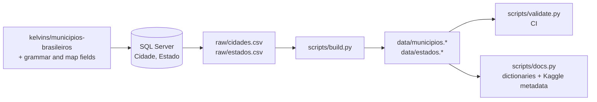

# Methodology

## 1. Origin

These two tables were the geographic backbone of several programmatic sites built by the author between 2020 and 2024, among them a portal of Brazilian registry offices crawled from the CNJ [Justiça Aberta](https://justicaaberta.cnj.jus.br/) system, where every office had to be tied to a municipality, a state, a phone area code and a map. They lived in SQL Server as `Cidade` and `Estado`.

The base fields (IBGE code, coordinates, capital flag, SIAFI code, DDD, time zone, and the state centre coordinates) match the public dataset **[kelvins/municipios-brasileiros](https://github.com/kelvins/municipios-brasileiros)** (MIT license), which is credited as the likely origin. See [THIRD-PARTY-NOTICES.md](../THIRD-PARTY-NOTICES.md).

Added by the author:

- `artigo`, `pronome` and `preposicao` for each state, the words a text generator needs to write "no Acre", "na Bahia", "em Goiás", "do Acre", "de Goiás" correctly.
- `mapa`: the IBGE boundary API URL for each municipality.
- `codigo_municipio`: the SIAFI code zero-padded to four digits.

## 2. Raw files

`raw/` holds the SQL Server export exactly as produced: semicolon separated, no header, decimal comma, UTF-8 with BOM.

`raw/cidades.csv` columns, in order:

| # | Column | Meaning |
|---|---|---|
| 1 | `id` | Internal id (1–5571, 3205 missing) |
| 2 | `cidade` | Name |
| 3 | `idEstado` | Internal state id (29–55), joins `estados.csv` column 1 |
| 4 | `codigo_municipio` | SIAFI code, 4 digits |
| 5, 6 | `latitude`, `longitude` | Decimal comma |
| 7 | `codigo_ibge` | IBGE code, 7 digits |
| 8 | `siafi_id` | SIAFI code without padding |
| 9 | `ddd` | Area code |
| 10 | `capital` | 1 = capital |
| 11 | `fuso_horario` | IANA zone (only 4 names used) |
| 12 | `mapa` | IBGE API v2 boundary URL |

`raw/estados.csv` columns: `id`, `estado`, `uf`, `cod_ibge`, `pronome` ("em" + article), `artigo`, `preposicao` ("de" + article), `latitude`, `longitude`.

## 3. Build

`scripts/build.py` reads both files and:

1. Types every column, converts decimal commas to points, and replaces internal ids with IBGE codes as keys.
2. Adds `region`, `name_ascii`, `slug` and `utc_offset` to municipalities; adds `capital`, `name_with_em` and `name_with_de` to states.
3. Replaces the time zone with the canonical IANA zone, fixes the article column, and moves boundary URLs to the IBGE API v3. Details in [data-quality.md](data-quality.md).



```bash
pip install -r requirements.txt
python scripts/build.py && python scripts/validate.py && python scripts/docs.py
```

## 4. Validation

`scripts/validate.py` checks, on every push:

- **Counts:** 5,570 municipalities and 27 states.
- **Uniqueness:** IBGE code, SIAFI code and slug are all unique.
- **IBGE codes:** the code prefix matches the state, and the check digit is valid (the 9 official exceptions are allowed).
- **Other fields:** DDDs come from the valid set and match their state (with 3 documented border exceptions), and coordinates fall inside Brazil.
- **Capitals:** exactly one per state.
- **Time zones:** each offset matches its zone, and both tables agree on each state's code and region.
- **Grammar:** the article and both prepositions are consistent with each other.
